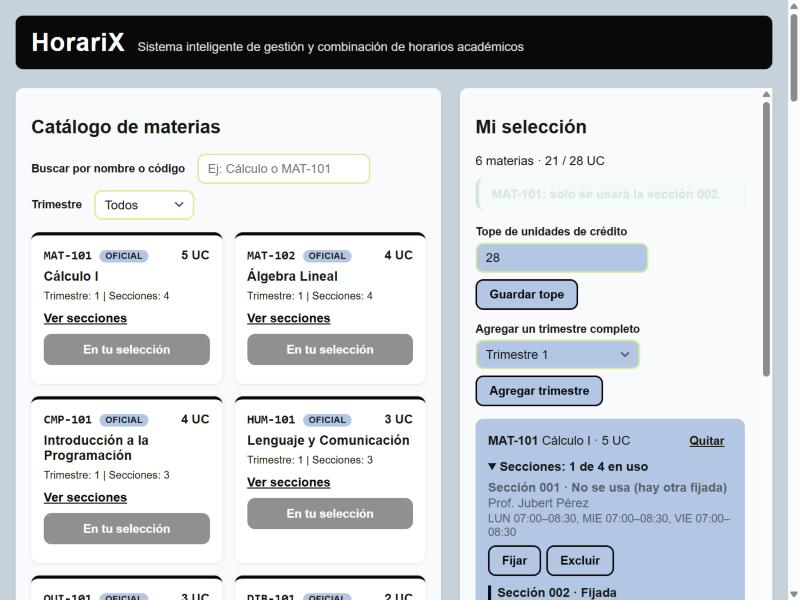
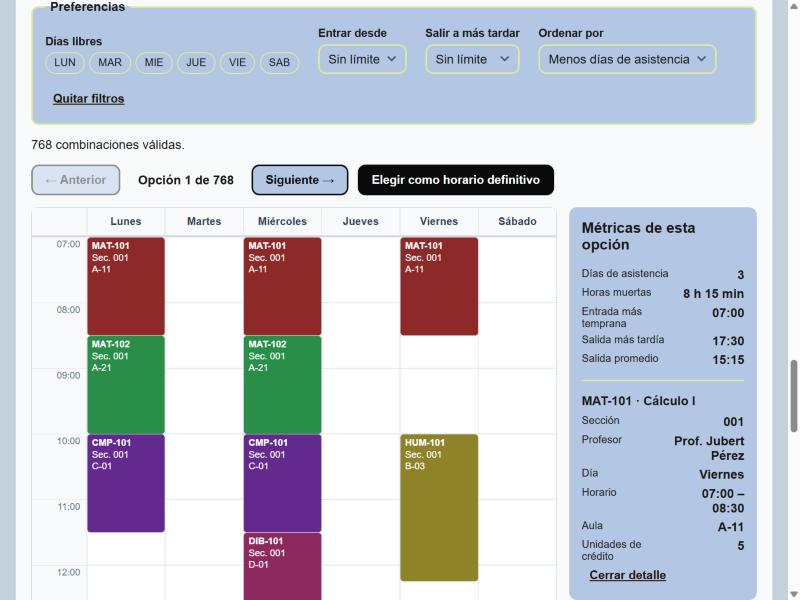
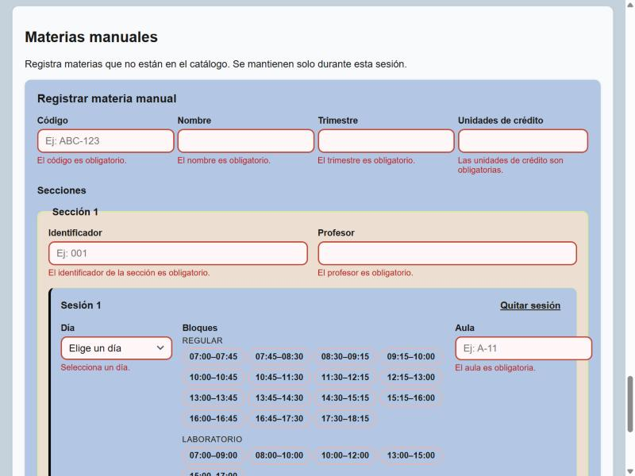
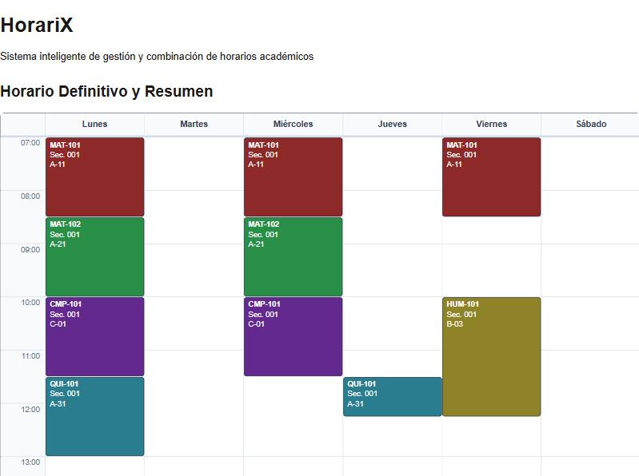
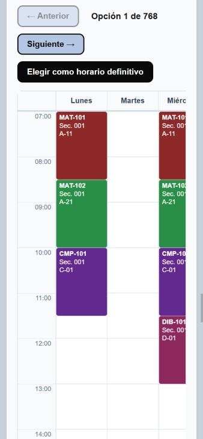

# HorariX

**HorariX** es una aplicación web de página única para armar el horario académico de un trimestre. El estudiante elige materias de un catálogo (o registra materias propias), la aplicación detecta los choques de horario, genera **todas** las combinaciones válidas de secciones y las muestra en una rejilla semanal. Los resultados se filtran por preferencias, se ordenan por conveniencia y, al final, uno se elige como horario definitivo con un resumen imprimible.

Todo corre en el navegador: HTML5, CSS3 y JavaScript puro, sin librerías, sin servidor y sin persistencia.

Proyecto 1 de *Desarrollo de Lenguajes para Clientes Web* — Prof. Ing. Victor Kneider.

## Integrantes y división del trabajo

| Integrante | Trabajo realizado |
| --- | --- |
| **Santiago Landaeta** | Estructura inicial del proyecto; módulos de conversión de horas (`tiempo.js`), acceso a datos (`datos.js`), catálogo (`catalogo.js`), estado de la selección con tope de UC, atajo de trimestre, fijar y excluir (`seleccion.js`), detección de choques e incompatibles (`choques.js`) y generador de combinaciones con descarte temprano (`generador.js`); estilos de la rejilla con CSS Grid, paleta de colores y hoja de impresión (`print.css`). |
| **Leandro Jay** | Buscador y filtro del catálogo; formulario de materias manuales con validaciones (`formulario.js`, `validaciones.js`, `interfaz.js`); panel de selección (`vistaSeleccion.js`); generación desde la interfaz, filtros y ordenamiento (`vistaResultados.js`, `preferencias.js`); rejilla semanal con navegación, métricas y detalle (`rejilla.js`); horario definitivo y resumen (`resumen.js`); estilos del formulario, del catálogo y de la distribución general. |

## Cómo ejecutarlo

1. Descargar o clonar el repositorio.
2. Abrir `index.html` con doble clic en cualquier navegador moderno (Chrome, Edge o Firefox).

No necesita servidor ni instalación. Los datos salen de `data/bloques.js` y `data/materias.js`; la aplicación funciona con cualquier otro par de archivos que respete la misma estructura.

## Cómo se usa

1. **Catálogo:** buscar por nombre o código (sin importar tildes ni mayúsculas) y filtrar por trimestre. "Ver secciones" despliega profesor, días, horas y aula de cada sección.
2. **Selección:** "Agregar" suma la materia respetando el tope de UC (28 por defecto, configurable). En el panel se pueden fijar o excluir secciones, y el atajo agrega un trimestre completo. Si dos materias no pueden cursarse juntas, el panel lo indica.
3. **Materias manuales:** el formulario registra materias que no están en el catálogo, con sus secciones y sesiones. Se pueden editar y eliminar.
4. **Generar horarios:** muestra cuántas combinaciones válidas existen. Cualquier cambio en la selección invalida los resultados hasta volver a generar.
5. **Filtros y orden:** días libres, hora mínima de entrada, hora máxima de salida y criterio de orden. La cantidad de resultados se actualiza con cada cambio.
6. **Rejilla:** "Anterior" y "Siguiente" (o las flechas del teclado) recorren las opciones. Al pulsar una sesión se ve su detalle completo.
7. **Horario definitivo:** "Elegir como horario definitivo" muestra el resumen con su rejilla y una tabla por materia. "Imprimir Horario" imprime solo esa vista.

## Criterios de ordenamiento

| Criterio | Qué mide | Se ordena |
| --- | --- | --- |
| Orden de generación | El orden en que el generador encontró las combinaciones. | Tal cual |
| Menos días de asistencia | Cantidad de días distintos con al menos una clase. | De menor a mayor |
| Menos horas muertas | Suma, en cada día, del tiempo entre el fin de una sesión y el inicio de la siguiente. | De menor a mayor |
| Salida más temprana | Promedio de la hora de salida de cada día con clases. | De menor a mayor |

Los empates conservan el orden de generación, porque el ordenamiento es estable.

## Métricas que se muestran junto a la rejilla

- **Días de asistencia:** días con al menos una clase.
- **Horas muertas:** total de huecos entre clases del mismo día.
- **Entrada más temprana:** la hora de inicio más temprana de la semana.
- **Salida más tardía:** la hora de fin más tardía de la semana.
- **Salida promedio:** el mismo valor que usa el criterio "Salida más temprana".

## Decisiones técnicas

- **Choques por horas, no por bloques.** Cada sesión se convierte a minutos desde la medianoche y dos sesiones chocan si son el mismo día y `inicioA < finB && inicioB < finA`. Con `<` estricto, una clase que termina a las 08:30 no choca con otra que empieza a las 08:30. Así también se detectan los laboratorios, que se superponen parcialmente con los bloques regulares.
- **Generación con descarte temprano (backtracking).** El generador elige una sección por materia; si la sección choca con las ya elegidas, descarta esa rama sin construir las combinaciones completas que la contienen.
- **Escala de la rejilla calculada.** Va desde la hora en punto anterior al primer bloque hasta la posterior al último. Cada fila mide el máximo común divisor de todas las horas del catálogo, así cada sesión es un único elemento con `grid-row: inicio / span duración` aunque el dataset cambie.
- **Resultados vigentes.** Al generar se guarda una "firma" de la selección (su contenido serializado). Si la selección cambia, la firma no coincide y los resultados se invalidan.
- **Sin `alert`, `confirm` ni `prompt`.** Todos los avisos, errores y confirmaciones de eliminación se integran al DOM.

## Estructura de archivos

```
index.html
css/
  styles.css          estilos de toda la aplicacion
  print.css           version imprimible del resumen
data/
  bloques.js          provisto por el profesor
  materias.js         provisto por el profesor
js/
  tiempo.js           conversion de horas y solapamiento de intervalos
  datos.js            acceso a bloques y materias (catalogo y manuales)
  interfaz.js         utilidades de dom compartidas y avisos
  catalogo.js         listado, busqueda, filtro y detalle de materias
  seleccion.js        estado de la seleccion, tope de uc, fijar y excluir
  choques.js          choques entre sesiones y materias incompatibles
  generador.js        combinaciones validas con descarte temprano
  preferencias.js     filtros, metricas y ordenamiento
  validaciones.js     reglas del formulario de materias manuales
  formulario.js       registro, edicion y eliminacion de materias manuales
  vistaSeleccion.js   panel "mi seleccion"
  rejilla.js          rejilla semanal con css grid
  vistaResultados.js  generar, filtrar, ordenar y navegar resultados
  resumen.js          horario definitivo y tabla resumen
  app.js              punto de entrada
```

Los scripts se cargan en ese orden desde `index.html`; cada archivo declara funciones globales que los siguientes usan.

## Decisiones de diseño

### Paleta de colores

Definida como variables en `:root` (`css/styles.css`), así toda la aplicación comparte los mismos valores.

| Variable | Color | Uso |
| --- | --- | --- |
| `--fondo` | `#c5d2db` | Fondo de la página |
| `--panel` | `#f8fafc` | Fondo de cada sección |
| `--superficie` | `#b3c7e4` | Tarjetas internas, campos y cabeceras de tabla |
| `--superficie-suave` | `#ecded1` | Fondo de cada sección del formulario |
| `--acento` | `#090909` | Cabecera, botones principales y bordes destacados |
| `--borde` | `#deec9d` | Bordes de campos y paneles |
| `--foco` | `#f59e0b` | Contorno de foco del teclado e insignia de materias manuales |
| `--error` / `--exito` | `#b91c1c` / `#15803d` | Avisos de error y de éxito |

Cada materia recibe en la rejilla un tono distinto, repartido con el ángulo áureo (137,5°) para que dos materias vecinas no se parezcan. Ese color se mantiene en todas las opciones y en el resumen.

### Tipografía

Arial y la fuente sans-serif del sistema para todo el texto, por legibilidad en pantalla y en papel. Los códigos de materia usan una fuente monoespaciada para que se lean como identificadores.

### Iconografía

No se usa una librería de íconos: los estados se comunican con color, insignias de texto ("Oficial", "Manual") y flechas tipográficas (← →) en la navegación. Así la interfaz se mantiene liviana y funciona igual en la versión impresa.

### Estados y accesibilidad

- Cada vista tiene estado vacío, de error y de éxito.
- Todos los controles tienen estado de *hover* y un contorno de foco visible al navegar con teclado.
- Las secciones fijadas y excluidas se distinguen con `aria-pressed`, y el detalle del catálogo con `aria-expanded`.
- Las animaciones respetan la preferencia de movimiento reducido del sistema.

### Inspiración

La vista semanal sigue el esquema de los calendarios de escritorio: días en columnas, horas en el eje vertical y cada clase como un bloque de color del alto de su duración.

## Capturas de pantalla

**Catálogo y panel de selección**, con una sección fijada:



**Resultados en la rejilla semanal**, con filtros, métricas y el detalle de una sesión:



**Formulario de materias manuales** mostrando errores junto a cada campo:



**Vista imprimible** del horario definitivo:



**En celular**, la rejilla se desplaza dentro de su contenedor sin romper la página:


